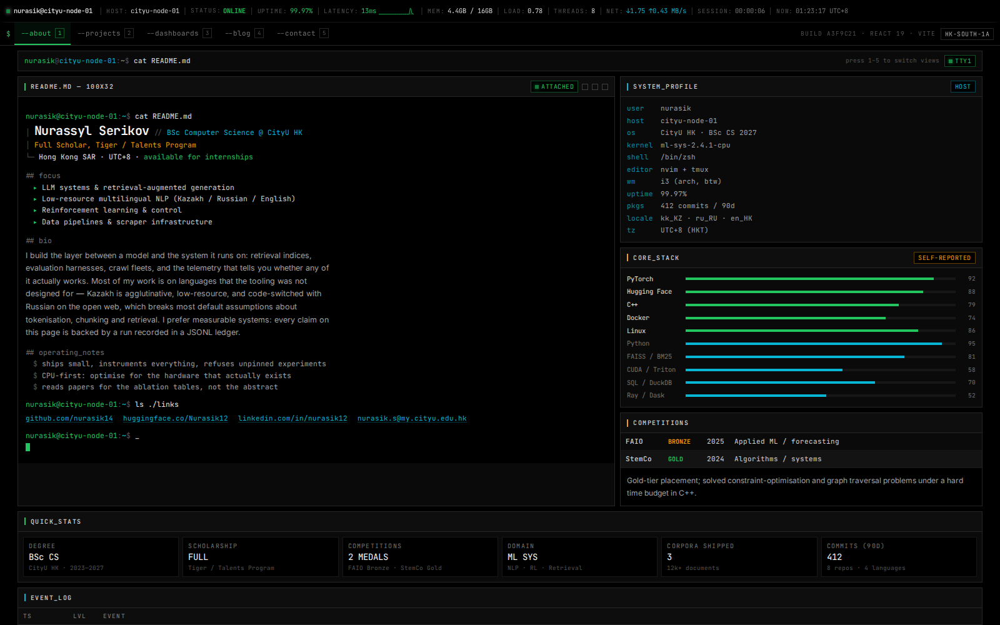
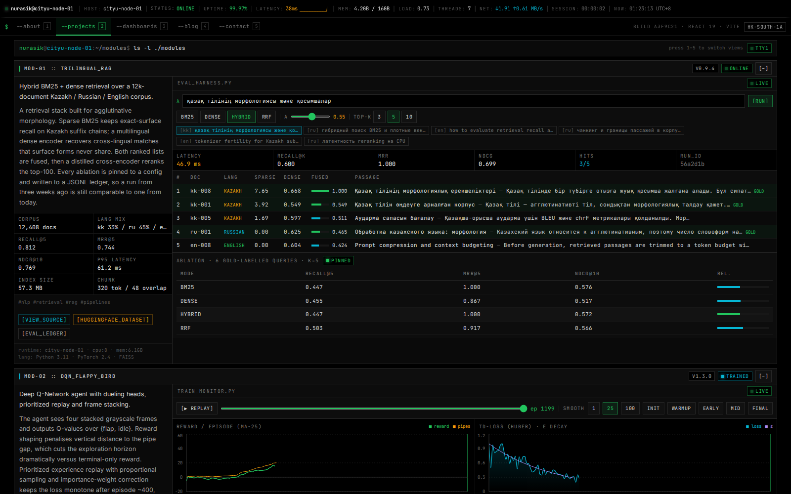
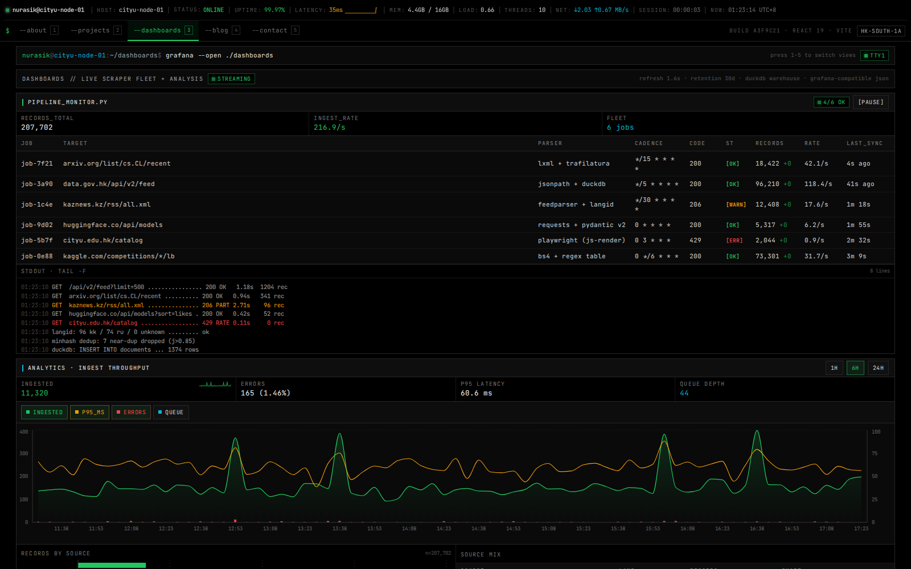

# nurasik@cityu-node-01 :: systems console

Personal portfolio of **Nurassyl Serikov** — BSc CS @ CityU HK. Built as a live
developer telemetry console (Grafana / Datadog / TUI aesthetic), not a landing page.



## Run

```bash
pnpm install
pnpm dev        # http://localhost:5173
pnpm build      # -> dist/
```

Stack: React 19 · Vite · Tailwind CSS 3 · Recharts · framer-motion.

## Editing content — everything lives in `src/config/`

No JSX changes are ever needed to update the site. Each file is plain data:

| File | Controls |
|------|----------|
| `site.config.js` | identity, links, nav tabs, top telemetry bar base values, breadcrumb commands, footer |
| `about.config.js` | bio, focus list, operating notes, system profile, stats matrix, stack bars, competitions, timeline, availability |
| `projects.config.js` | the three modules: metadata, spec metrics, links, tags, descriptions |
| `blog.config.js` | syslog posts — `body` is raw markdown (headings, tables, code fences) |
| `rag.config.js` | trilingual corpus slice + gold evaluation queries (qrels) |
| `dashboards.config.js` | scraper jobs, stdout log pool, chart ranges, analytics series shape, raw JSON/CSV/SQL inspector contents |
| `experiments.config.js` | DQN seed/eps/checkpoints, MediaPipe latency model + stage breakdown |

All telemetry curves are generated deterministically from seeds in the config —
change a seed, get a different (but reproducible) run.

## Views

`--about` readme terminal · `--projects` interactive modules (live RAG eval
harness, DQN training replay, pose-to-cursor probe) · `--dashboards` scraper
fleet monitor + analytics + raw output inspector · `--blog` git-log syslog ·
`--contact` channels. Keyboard: press `1–5` to switch.



