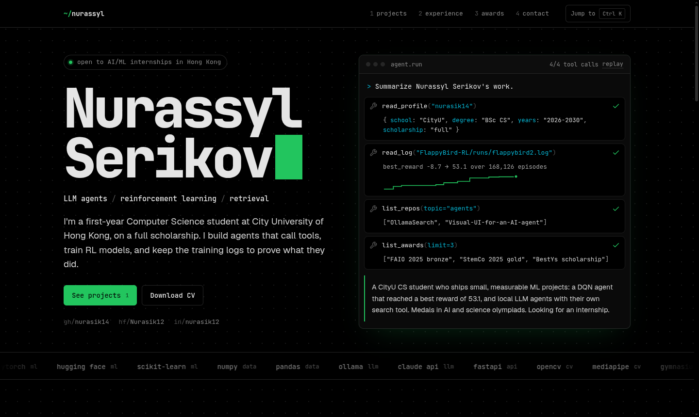
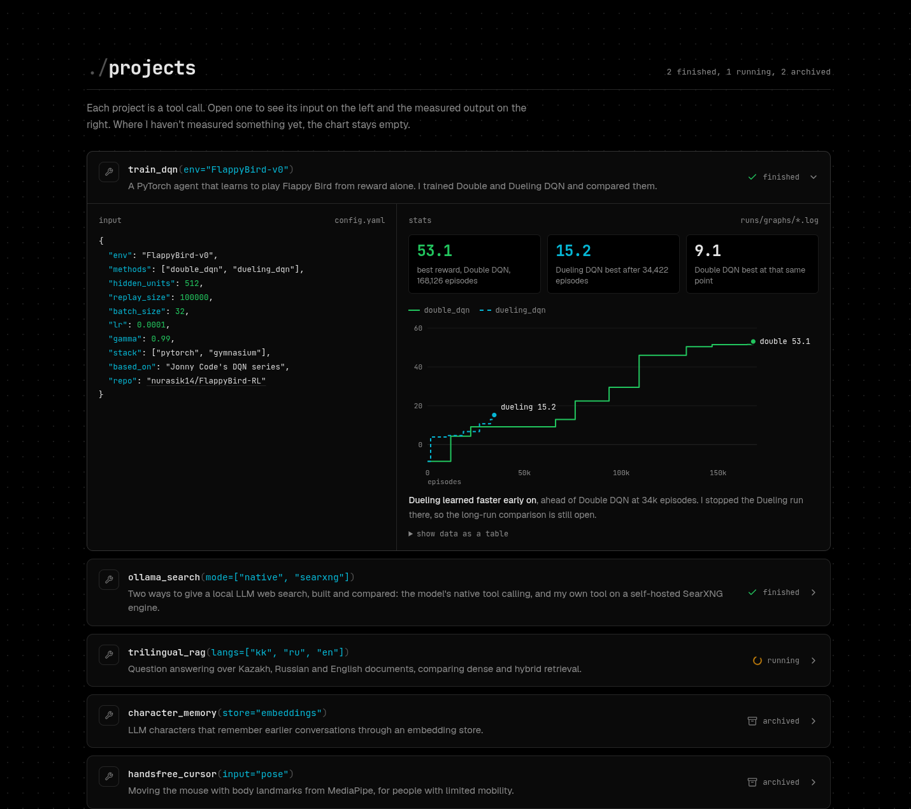
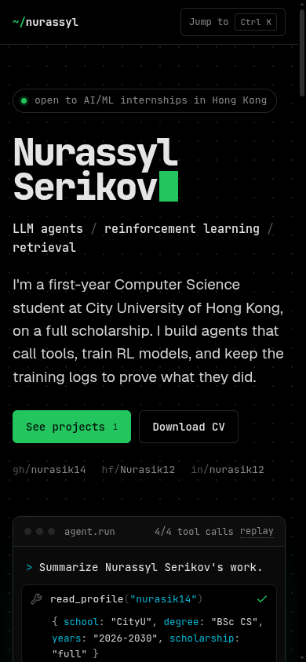
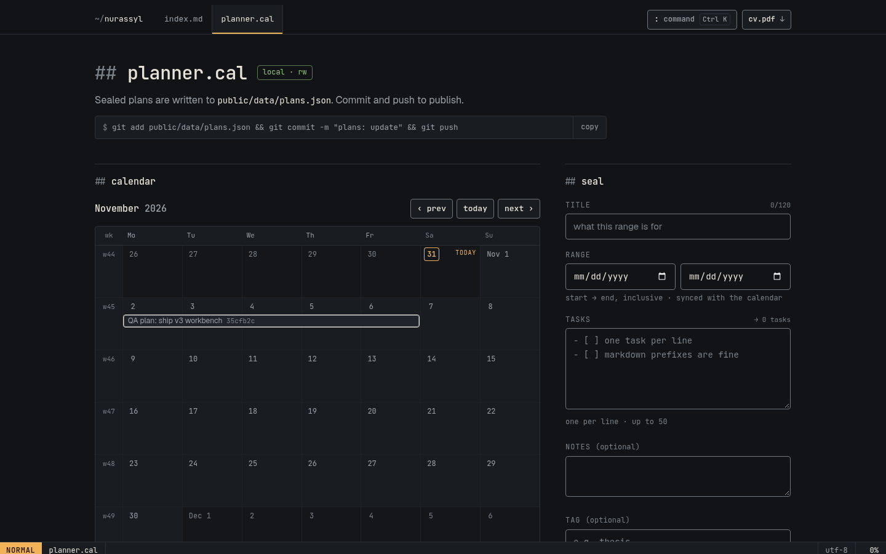

<!-- Cosmic Banner -->
<p align="center">
  
</p>

<h1 align="left"> I'm <b>Nurasik12</b></h1>

<p align="center">
  <i>"Every man has two lives, and the second starts when he realizes he has just one." — Confucius</i>
</p>

---

## About Me

- I explore **AI, ML, RL, mathematics, and engineering**
- I want to build things that stay, inspire, and evolve.

---

## Tech

<p align="center">
  
</p>

---

## Contacts

<p align="center">
  <a href="mailto:nurasik.s@my.cityu.edu.hk"></a>
  <a href="https://github.com/nurasik14"></a>
  <a href="https://t.me/nurasik12"></a>
  <a href="https://linkedin.com/in/nurasik12"></a>
  <a href="https://huggingface.co/Nurasik12"></a>
</p>

---

## Portfolio

**Live site → https://nurasik14.github.io/nurasik14/**

This repository also hosts my portfolio site (React 19, Vite, Tailwind, run with bun). It is styled as
an editor session with two open buffers: `index.md`, the portfolio, and `planner.cal`, my planner at
`/planner/`. A vim-like statusline at the bottom shows the real mode, buffer, section and scroll
position, and `:` opens a command line. The hero shows real DQN training curves (fig. 1). Projects
are an experiments ledger: each row expands to show its config as YAML and its measured results.
The planner can also sync with Google Calendar on localhost: sealed plans are pushed to a dedicated
`planner.cal` calendar, and event titles and times are published as a dashed overlay
(see [docs/PLANNER.md#google](./docs/PLANNER.md#google)).



<p>
  
  
</p>



```bash
bun install
bun run dev     # http://localhost:5173/  (planner: http://localhost:5173/planner/)
bun run build   # static site in dist/
```

All content lives in `src/config/portfolio.config.js`. See [MAINTAINING.md](./MAINTAINING.md).

Pushing to `main` redeploys the site automatically via GitHub Actions.
