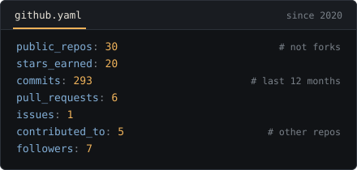
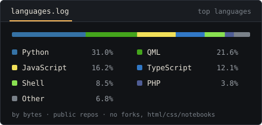
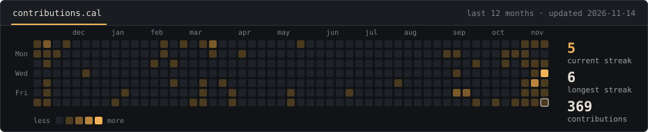
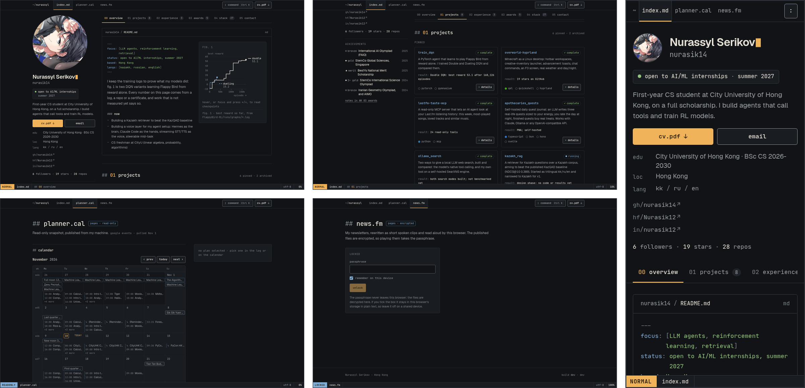

<!-- Banner -->
<p align="center">
  
</p>

<h1 align="center">I'm <b>Nurasik12</b></h1>

<p align="center">
  <a href="https://nurasik14.github.io/nurasik14/">
    
  </a>
</p>

<p align="center">
  <i>"Every man has two lives, and the second starts when he realizes he has just one." — Confucius</i>
</p>

<p align="center">
  
  
  
  
</p>

---

## `$ whoami`

```yaml
name:    Nurassyl Serikov              # a.k.a. Nurasik
route:   Taraz, Kazakhstan -> Hong Kong
study:   BSc Computer Science @ City University of Hong Kong   # 2026-2030, full scholarship
focus:   [LLM agents & tool use, retrieval (RAG), reinforcement learning]
speaks:  [kazakh, russian, english]
status:  open to AI/ML internships for summer 2027
```

- **Building:** a Kazakh retriever meant to beat the published KazQAD baselines, a voice layer for my agent setup, MCP servers that give agents real tools, and a Minecraft-themed Linux desktop.
- **How I work:** I run Hermes Agent as my orchestrator and hand coding to Claude Code, and I keep the logs. If one of my READMEs has a number, a training run or an eval produced it.
- **Learning:** linear algebra, probability and algorithms at CityU, and how transformers work under the hood.
- **Olympiads:** International AI Olympiad (FAIO) bronze 2025 · StemCo Global Sciences gold 2025 · Iranian Geometry Olympiad bronze 2024.

## `$ cat goals.md`

I want language models to work as well in Kazakh as they do in English. Low-resource languages get
worse retrieval, worse evals and fewer datasets, and I want to fix a piece of that. Alongside it, I
build agents that do useful work with real tools and leave logs you can check.

- [x] Get into CityU on a full scholarship
- [x] Train a DQN agent from reward alone and publish the curves
- [ ] Beat the KazQAD retrieval baseline (NDCG@10 0.389) with my own Kazakh retriever
- [ ] Release the retriever and its eval set on Hugging Face
- [ ] Land an ML/AI internship for summer 2027
- [ ] Write up the retrieval results as a first paper or workshop submission
- [ ] Turn my agent setup into an always-on coworker I can talk to (below)

### Next build: a voice for my agents

Today I type to [Hermes Agent](https://github.com/NousResearch/hermes-agent), which plans the work and
runs Claude Code as a subprocess to write the code. The plan is to give that setup a voice, so that it
feels like one session that never ends: I talk, it keeps working in the background, and I can cut in
mid-task to change direction without starting over.

```text
 me (mic / speaker)
      |  ^
      v  |
 voice layer  -- the mouth --   streaming STT -> polisher -> streaming TTS
      |  ^                      (polisher: drops filler words, fixes STT slips,
      v  |                       decides "command" vs "thinking out loud")
 Hermes Agent -- the brain  --   plans, remembers, decides, steers
      |  ^
      v  |
 Claude Code  -- the hands  --   edits files, runs commands, reports back
```

- [ ] Streaming STT and TTS with barge-in: when I start speaking, playback stops at once and the words go to Hermes.
- [ ] Polisher: a small local model (Ollama) cleans the transcript and tags it as a command or a thought.
- [ ] Steering instead of restarting: interruptions reach Hermes as mid-turn messages; Hermes decides whether to stop the Claude Code subprocess or let it finish.
- [ ] Two outputs from the brain: a short spoken summary for the TTS, and the full log for the screen.
- [ ] Proactive updates: it speaks up when a long task finishes or needs approval, not only when asked.
- [ ] Long-running memory: older turns get compressed into a running task summary so the session can last for days.

## `$ ls ~/projects`

| project | what it does | stack |
|:--|:--|:--|
| [**overworld-hyprland**](https://github.com/nurasik14/overworld-hyprland)  | Minecraft as a Linux desktop: hotbar workspaces, creative-inventory launcher, advancement toasts, real weather and day/night | QML, Quickshell, Hyprland |
| [**Apothecaries-quests**](https://github.com/nurasik14/Apothecaries-quests) | Self-hosted quest journal: an LLM writes three real-life quests sized to your energy | TypeScript, Bun, Hono, Svelte |
| [**lastfm-taste-mcp**](https://github.com/nurasik14/lastfm-taste-mcp) | Read-only MCP server that lets an agent explore your Last.fm listening history | Python, MCP |
| [**FlappyBird-RL**](https://github.com/nurasik14/FlappyBird-RL) | Double vs Dueling DQN. Best reward 53.1 after 168,126 episodes | PyTorch, Gymnasium |
| [**OllamaSearch**](https://github.com/nurasik14/OllamaSearch) | Web search for a local LLM: native tool calling vs my own tool on self-hosted SearXNG | Python, Ollama, SearXNG |
| [**Kazakh-RAG**](https://github.com/nurasik14/Kazakh-RAG) | Question answering over a Kazakh corpus, starting with a retriever (design phase) | Python, Hugging Face |
| [**CityUHK_job_scraper**](https://github.com/nurasik14/CityUHK_job_scraper) | Scrapes CityU internship and student-helper boards; Claude rates each job against what you want | Python, Claude, Ollama |
| [**apothecary-hyprland-conf**](https://github.com/nurasik14/apothecary-hyprland-conf) | Switchable Hyprland theme from *The Apothecary Diaries*, with live light/dark | QML, Bash |

## `$ stack --list`

<table>
  <tr>
    <td><b>agent harnesses</b></td>
    <td>
      <a href="https://github.com/NousResearch/hermes-agent"></a>
      <a href="https://github.com/anthropics/claude-code"></a>
      
    </td>
  </tr>
  <tr>
    <td><b>languages</b></td>
    <td></td>
  </tr>
  <tr>
    <td><b>ml / ai</b></td>
    <td>
      <br>
      
      
      
      
      
      
      
    </td>
  </tr>
  <tr>
    <td><b>web / backend</b></td>
    <td></td>
  </tr>
  <tr>
    <td><b>tools / os</b></td>
    <td>
      <br>
      
      
      
    </td>
  </tr>
</table>

## `$ gh stats`

<p align="center">
  
  
</p>
<p align="center">
  
</p>
<p align="center">
  <picture>
    <source media="(prefers-color-scheme: dark)" srcset="https://raw.githubusercontent.com/nurasik14/nurasik14/output/snake.svg">
    
  </picture>
</p>

<sub>The cards are rebuilt daily from the GitHub API by <a href="./scripts/profile_stats.py"><code>scripts/profile_stats.py</code></a> (<a href="./.github/workflows/profile-stats.yml">workflow</a>), so they don't depend on a third-party stats server.</sub>

## `$ contact`

<p align="center">
  <a href="mailto:nurasik.s@my.cityu.edu.hk"></a>
  <a href="https://github.com/nurasik14"></a>
  <a href="https://t.me/nurasik12"></a>
  <a href="https://linkedin.com/in/nurasik12"></a>
  <a href="https://huggingface.co/Nurasik12"></a>
</p>

---

## `$ open portfolio`

**Live site → https://nurasik14.github.io/nurasik14/**

My portfolio is laid out like a GitHub profile, running inside a code editor. On the left is a
profile sidebar. On the right are tabs, a `README.md` panel with real DQN training curves, pinned
project cards that expand into their config and measured results, and a contribution graph built from
the GitHub API. The editor parts are real: buffer tabs (`index.md`, `planner.cal` for my planner,
`news.fm` for my weekly news read aloud), a vim-style statusline, and a `:` command line. Number keys
jump between sections.

<a href="./screenshots/demo.png"></a>

<p align="center"><sub>profile · pinned projects · planner.cal · news.fm · phone. Click for full size, or open the
<a href="./screenshots/">individual screenshots</a>.</sub></p>

<details>
<summary><b>Run it locally</b></summary>

<br>

React 19, Vite, Tailwind, run with bun.

```bash
bun install
bun run dev     # http://localhost:5173/  (planner: /planner/, news: /news/)
bun run build   # static site in dist/
```

- All portfolio content lives in `src/config/portfolio.config.js`. See [MAINTAINING.md](./MAINTAINING.md).
- On localhost the planner can sync with Google Calendar: sealed plans go to a dedicated `planner.cal`
  calendar, and event titles and times are published as a dashed overlay ([docs/PLANNER.md](./docs/PLANNER.md#google)).
- `news.fm` wrap-ups are encrypted before they are published ([docs/NEWS.md](./docs/NEWS.md)).
- Pushing to `main` redeploys the site via GitHub Actions.
- Stat cards locally: `GITHUB_TOKEN=$(gh auth token) python3 scripts/profile_stats.py --out stats`

</details>
